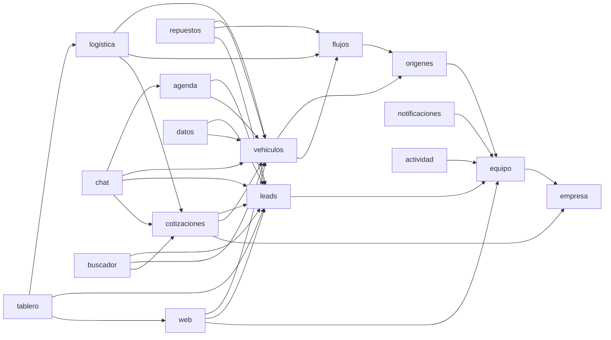

# Arquitectura

**Nivel:** 2 — monolito modular. La razón está en `docs/DECISIONES.md`.
El índice vivo de módulos, rutas y tablas es `docs/MAPA.md` (generado). Este archivo explica cómo
encajan; el mapa dice qué hay.

## Piezas y dependencias

Las flechas van en un solo sentido. Un ciclo entre módulos es un error de diseño: se resuelve con
un evento o con una función que el módulo de abajo expone, no importándose mutuamente. `equipo` y
`empresa` están abajo de todo (permisos y ajustes); `buscador`, `tablero` y `datos` arriba de todo
(componen a los demás por su API pública).

## Capas

| Desde (dentro de un módulo) | Puede importar                                                               |
| --------------------------- | ---------------------------------------------------------------------------- |
| `features/`                 | `entities/` del mismo módulo, `@/shared`, las entradas de `@/modules/<otro>` |
| `entities/`                 | `@/shared`                                                                   |
| `infra/`                    | `entities/` del mismo módulo, `@/shared`                                     |
| `src/app/`                  | las entradas de `@/modules/<x>`, `@/shared`                                  |
| `src/shared/`               | `src/shared/`                                                                |

`features` no importa `infra`: los casos de uso dependen de la interfaz de repositorio que declara
`entities`, y la composición del módulo (`composicion.ts` en el servidor, `composicion.client.ts`
en el navegador) decide qué implementación concreta reciben. Lo verifica
`eslint-plugin-boundaries`; la regla entre módulos la verifica además `scripts/mapa.sh --check`.

Un módulo tiene **dos entradas** y nada más se importa desde afuera:

- `@/modules/<x>` (`index.ts`) — para Server Components. Puede traer código de servidor
  (`server-only`, actions, lecturas), así que un Client Component que la importe rompe el build.
- `@/modules/<x>/client` (`client.ts`) — para Client Components de `app/` o de otro módulo: hooks,
  componentes de cliente y tipos de `entities/`. Nunca nada de servidor.

`composicion*.ts` es privado del módulo aunque esté en su raíz.

## Dónde va cada cosa

- `src/proxy.ts` — refresco de sesión; Next 16 lo exige al nivel de `app/`, no adentro.
- `src/app/` — rutas (App Router), `layout.tsx`, `manifest.ts`, route
  handlers (`api/portal`, `api/revalidar`, `api/push`, `api/pdf`). Composition root.
- `src/modules/<dominio>/index.ts` — API pública del módulo (servidor); `client.ts` — la de cliente.
- `src/modules/<dominio>/features/<caso>/` — `components/`, `hooks/`, `actions/`, `schemas/`.
- `src/modules/<dominio>/entities/` — tipos, reglas puras, `puede()`, transiciones, interfaces.
- `src/modules/<dominio>/infra/` — repositorios Supabase (`queries/`, `*.client.ts`), adaptadores.
- `src/shared/ui/` — shadcn + componentes transversales: `XCell`, `FilterShell`, `Drawer`,
  `Modal`, `Bloque`, `Monto`, `Badge`, `Confirmar`, `estados/`, `esqueletos/`.
- `src/shared/lib/` — `supabase/` (server, browser, admin, proxy), `safe-action.ts`,
  `permisos.ts` (`puede()`), `formato.ts`, `fechas.ts`, `errores.ts`, `imagenes/`.
- `src/shared/types/database.types.ts` — generado.
- `supabase/schemas/<dominio>/` · `supabase/migrations/` · `supabase/functions/<nombre>/` ·
  `supabase/tests/humo.sql`.
- `e2e/` — Playwright de los flujos críticos (tareas de oro de `docs/UX.md`).

## Cómo viaja una operación

«Mover un vehículo a la fase Embarcado» (tarea de oro 3):

1. `app/(app)/logistica/page.tsx` (Server Component) lee la cadena con
   `logistica.cadenaPorFlujo(origenId)` (query de `infra/`, bajo RLS del usuario) y pasa los datos
   al componente `features/cadena/components/Cadena`.
2. El usuario abre el panel del vehículo: el hook `usePrevisualizarCambio` llama a la action
   `previsualizarCambioFase` → RPC `previsualizar_cambio_fase` → devuelve `ok`, motivos y requisitos
   evaluados; la UI muestra «qué falta» antes del clic.
3. Clic en «Mover a Embarcado» → `cambiarFase` (action con `next-safe-action`): valida con Zod,
   comprueba `puede(permisos, 'flujos.mover', origenId)` en `entities/`, llama a la RPC
   `cambiar_fase(vehiculo, null, fase, nota, fase_esperada)`.
4. La RPC (única puerta que escribe `fase_id`) repite la secuencia: viva → destino existe y activo
   → transición o inicial → rol → requisitos bloqueantes → escribe `vehiculos.fase_id`,
   `historial_fases`, `notas` y `actividad` en una transacción. Conflicto → `PT409`.
5. La action traduce el resultado a `{ ok }` o `{ ok: false, error: { codigo: 'conflicto' } }`,
   `revalidatePath('/logistica')`; la UI muestra el toast o el aviso «Rosa lo movió hace 1 min ·
   Recargar». Si se marcó un lote, `cambiar_fase_lote` devuelve ok/motivo por unidad y la UI
   muestra el resultado parcial.

## Mecanismos transversales

- **Permisos**: catálogo fijo en `supabase/seed.sql` (`permisos`) + `src/shared/lib/permisos.ts`
  (mismas claves, tipadas). `puede(permisos, clave, origenId)` en `entities/`; en la base,
  `tiene_permiso()` / `alcance_de()` en policies y RPC. La UI esconde o deshabilita; la base decide.
- **Auditoría**: tabla `actividad` escrita por el trigger `auditar()` y por `registrar_actividad()`
  desde las RPC. Purga a 14 días (`ajustes_empresa.actividad_dias`).
- **Estados**: fases como datos (`flujos`, `fases`, `fases_transiciones`) y un único motor
  `cambiar_fase`. Las reglas que la UI necesita (transiciones permitidas, qué falta) salen de
  `previsualizar_cambio_fase`, nunca se reimplementan en componentes.
- **Conflictos**: `actualizado_en` + `p_*_esperado` → `PT409` → `codigo: 'conflicto'`.
- **Trabajo en segundo plano**: `supabase/functions/` (`storage-gc`, `push`, `apibara`,
  `importar-csv`) + `pg_cron` (recordatorios, expirar turnos, alertas de demora, purgas).
- **Realtime**: canales de Supabase para chat y notificaciones; la fila es señal, se rehidrata por fetch.
- **Modo Live**: `useLive()` + `<Monto>`; clase en `<html>`; todo monto pasa por ahí.
- **Filtros en URL**: `nuqs` con esquema declarativo por listado y `FilterShell`.
- **Tema**: tokens en `design/tokens.css` → `src/app/globals.css` (`@theme`), modo oscuro por
  clase `.dark`, preferencia por usuario.

## Cuando crees una unidad nueva

1. Carpeta en `src/modules/<dominio>/` con su `CLAUDE.md` de ficha (plantilla en cualquier módulo
   existente). Sin ficha, `scripts/mapa.sh --check` falla.
2. Su API pública en `index.ts`. Nada más se importa desde afuera.
3. Términos nuevos del negocio → `docs/GLOSARIO.md`.
4. `bash scripts/mapa.sh` (el hook Stop lo corre solo; el pre-commit lo verifica).
